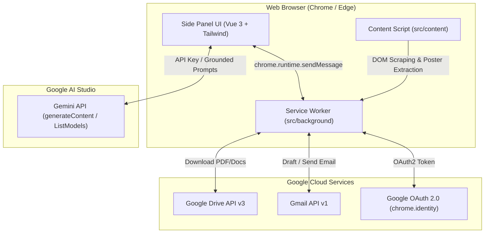

# Job Seek Assistant 🚀
### Chrome & Microsoft Edge Extension (Manifest V3)

> **AI-Powered Job Application Assistant with Grounded CV Memory, Real-time Web Scraping, Multi-Language Email Generation, and Direct Gmail Dispatch.**

Job Seek Assistant is an enterprise-grade Manifest V3 browser extension built with Vue 3, TypeScript, and Tailwind CSS. Designed to accompany job seekers end-to-end, it extracts job postings from active career portals and social media flyers, analyzes candidate-job fit (*match score & gap analysis*) objectively without hallucination, generates personalized cover emails across multiple tones and languages, and drafts or dispatches them directly via the official Gmail API with original CV attachments.

---

## ✨ Key Features

- **🖥️ Modern Chrome Side Panel UI**: Responsive, fluid interface seamlessly integrated into the browser's side panel, preserving natural web browsing flows without intrusive popup windows.
- **👋 Welcome / Landing Screen & Onboarding**:
  - Dedicated initial onboarding view when the extension is first installed or after concluding a demo session.
  - Access control locking primary tabs until the user either logs in via Google Workspace or starts a simulated Demo session.
  - Post-login Gemini API Key modal with a direct link to Google AI Studio for immediate configuration.
  - Contextual CV setup guidance banner on the Analysis tab before starting job extraction.
- **📁 Google Drive CV Memory & Synchronizer**:
  - Direct document picker from Google Drive v3 (supporting **PDF** & **Google Docs** formats).
  - Self-contained, offline-capable PDF text extraction via bundled PDF.js worker and Google Docs plain text export.
  - File change detection (*timestamp & MD5 checksum*) with one-click synchronization.
  - Structured manual CV fallback for users without Google Workspace accounts.
- **🌐 Active Web Job Scraper Engine**:
  - Specialized content script extractors for top career portals: **LinkedIn Jobs**, **Glints**, **Jobstreet / SEEK**, and **Indeed**.
  - **📸 Instagram Job Flyer Multimodal Extractor (v1.2.0)**: Dedicated extractor for Instagram job posts (`/p/*`, `/reel/*`) combining caption text and carousel/poster images processed via Gemini Multimodal Vision.
  - Universal heuristic extractor targeting independent enterprise career sites (Greenhouse, Lever, Workable, Ashby, etc.).
  - Automated text sanitization neutralizing indirect prompt injection attacks.
- **🧠 Gemini AI Grounded Match & Gap Analysis**:
  - Powered by Google Gemini reasoning models (`gemini-2.0-flash` / `gemini-1.5-flash`).
  - Strict context isolation via designated XML tags (`<candidate_cv>`, `<job_posting>`).
  - *Zero-hallucination guardrails*: The model is strictly prohibited from inventing skills or experience outside the candidate's CV.
  - Comprehensive metrics: Relevance Score (0–100%), Matched Skills with verbatim CV evidence citations, Missing Skills (gap analysis with actionable recommendations), and Interview Highlights.
- **✉️ Multi-Tone & Multi-Language Email Generator**:
  - 3 instant tone variations: **Formal**, **Impact / Project-focused**, and **Concise Pitch**.
  - Flexible language options: **English**, **Bahasa Indonesia**, or **Auto (matching the vacancy description)**.
  - **Iterative Refinement**: Refine and polish email drafts with natural-language revision prompts.
  - Automated recruiter email address detection from scraped job pages and flyer posters.
- **📬 Dual Gmail Dispatch**:
  - **Save to Drafts**: Creates official drafts in the user's Gmail mailbox (`users.me.drafts.create`).
  - **Direct Send**: Sends application emails directly via the Gmail API (`users.me.messages.send`) with a confirmation modal.
  - Encapsulated RFC 2822 base64url MIME payload generation with optional inclusion of the candidate's original PDF CV from Google Drive as an attachment.
- **🛡️ Error Resilience, Session Recovery & Anti-Stuck Safeguards**:
  - Automatic detection of expired Google OAuth sessions with seamless redirection to the welcome view and informative alert banners.
  - Proactive client-side Client ID format validation (preventing accidental entry of Gemini API Keys `AIza...`).
  - Anti-freeze safeguards featuring an interactive *Cancel* button and a 45-second safety timeout.
  - Offline network detection with automated UI alert banners.
  - **Comprehensive Demo Mode Simulation** complete with persistent status indicators across navigation tabs and a quick *"End Demo"* action.

---

## 🏗️ System Architecture



---

## 📋 Prerequisites

- **Node.js**: Version `>= 18.0.0` (Node.js 20 LTS or 22 LTS recommended).
- **Package Manager**: `npm` (bundled with Node.js).
- **Google Chrome** (v116+) or **Microsoft Edge** (v116+) with Manifest V3 Side Panel API support.
- *(Optional)* **Google Gemini API Key**: Obtain for free at [Google AI Studio](https://aistudio.google.com/). *(Demo Mode is available without an API key).*
- *(Optional)* **Google Cloud Console OAuth 2.0 Client ID**: For live Google Drive & Gmail integration. *(Demo Mode is available without GCP credentials).*

---

## 🚀 Quickstart Installation Guide

### 1. Clone & Install Dependencies
```bash
git clone https://github.com/IlhamFatahillahR27/job-seek-assistant.git
cd job-seek-assistant
npm install
```

### 2. Run Development Server or Build for Production
- For development with hot-module reloading:
  ```bash
  npm run dev
  ```
- To build the optimized production package:
  ```bash
  npm run build
  ```
  *The compiled extension will be output to the `dist/` directory, and a packaged release zip will be generated in `release/crx-job-seek-assistant-1.2.0.zip`.*

### 3. Load Extension into Google Chrome
1. Open Google Chrome and navigate to `chrome://extensions/`.
2. Enable **"Developer mode"** in the top-right corner.
3. Click **"Load unpacked"** in the top-left corner.
4. Select the `dist/` folder inside this project directory.
5. **Job Seek Assistant** will now appear in your extensions list.
6. Pin the extension icon to your browser toolbar, then click it to open the Side Panel.

### 4. Load Extension into Microsoft Edge
1. Open Microsoft Edge and navigate to `edge://extensions/`.
2. Enable **"Developer mode"** in the left sidebar.
3. Click **"Load unpacked"**.
4. Select the project's `dist/` folder.
5. Click the extension icon to open the Side Panel.

---

## ⚙️ Configuration Guide

### A. Google Workspace Setup (OAuth 2.0 Client ID)
1. Create or use an OAuth 2.0 Client ID of type **Web application** in the [Google Cloud Console](https://console.cloud.google.com/apis/credentials).
2. Copy the template `.env.example` file to `.env`:
   ```bash
   cp .env.example .env
   ```
3. Set your Client ID in `VITE_GOOGLE_CLIENT_ID`:
   ```env
   VITE_GOOGLE_CLIENT_ID=your-client-id.apps.googleusercontent.com
   ```
4. Add the extension's redirect URI to *Authorized redirect URIs* in Google Cloud Console:
   - Obtain the URI from the Settings tab or use `https://<EXTENSION_ID>.chromiumapp.org/`.
   - Add it to: Google Cloud Console -> Credentials -> OAuth 2.0 Client ID -> Authorized redirect URIs.
5. Run `npm run build` — the Client ID will be automatically embedded at build time without requiring manual entry by end users.
6. *(Alternative)* Click **"Try Demo Mode"** on the Welcome screen to simulate Google Drive & Gmail without GCP credentials.

### B. Google Gemini API Setup
1. Visit [Google AI Studio](https://aistudio.google.com/) and create an API Key.
2. Upon logging in for the first time, a setup modal will appear automatically, or you can open the **Settings** tab in the Side Panel.
3. Paste the API Key into the **Google Gemini API Key** field and click **"Test Connection"**.
4. Select your preferred model (default: `gemini-2.0-flash` or reasoning model `gemini-2.0-flash-thinking-exp`).
5. *(Alternative)* Enable **"Gemini AI Simulation Mode (Demo)"** to evaluate features without an API key.

---

## 🛠️ Development & Testing Scripts

| Command | Description |
| :--- | :--- |
| `npm run dev` | Starts the Vite development server with `@crxjs/vite-plugin` integration. |
| `npm run test` | Executes the complete automated test suite using **Vitest** (19 test suites, 137 tests). |
| `npm run test:watch` | Runs Vitest in interactive watch mode. |
| `npm run build` | Performs TypeScript typechecking (`vue-tsc -b`), bundles the extension to `dist/`, and creates the release zip archive in `release/`. |

---

## 🧪 Automated Test Suite

The project includes 19 comprehensive test suites covering 137 unit tests (100% passing):
- `tests/unit/job-scrapers.spec.ts`: DOM parsing for LinkedIn, Glints, Jobstreet/SEEK, Indeed, and Instagram post scrapers.
- `tests/unit/cv-parser.spec.ts`: PDF & Google Docs text extraction, PDF.js worker integration, and sanitized fallback validation.
- `tests/unit/reference-cv.spec.ts`: Real-world CV reference document extraction validating structured profile attributes.
- `tests/unit/gemini-client.spec.ts`: Gemini API client, key validation, multimodal payload formation, and automated model fallback.
- `tests/unit/welcome-flow.spec.ts`: Onboarding view lifecycle, Demo mode transitions, API key modals, and session expiration redirects.
- `tests/unit/error-resilience.spec.ts`: Offline resilience, silent 401 re-authentication, 404 handling, and rate limit 429 recovery.
- `tests/unit/cv-sync.spec.ts`: Google Drive file change detection and timestamp synchronization.
- `tests/unit/job-extractor.spec.ts`: Heuristic fallback extractor and AI-assisted extraction composable.
- `tests/unit/sanitizer.spec.ts`: Text sanitization, HTML stripping, and indirect prompt injection defense.
- `tests/unit/gemini-guardrail.spec.ts`: Anti-hallucination constraints and grounded skill matching evaluation.
- `tests/unit/email-generator.spec.ts`: Multi-tone, multi-language email generation and iterative prompt refinement.
- `tests/unit/mime-builder.spec.ts`: RFC 2822 base64url MIME message synthesis with PDF attachments.
- `tests/unit/gmail-client.spec.ts`: Draft creation and direct email dispatch via Gmail API.
- `tests/unit/google-auth.spec.ts`: OAuth2 flow, token refresh, Client ID validation, and session lifecycle.
- `tests/unit/storage.spec.ts`: Reactive wrapper around `chrome.storage.local`.
- `tests/unit/sidepanel-tabs.spec.ts`: Tab navigation rendering and Side Panel UI integrity.
- `tests/unit/use-email-generator.spec.ts`: State management composable for the email generation pipeline.
- `tests/unit/job-analysis.spec.ts`: Composable managing candidate-job analysis states.

For QA procedures and error handling matrices:
- **Manual Verification Guide**: [`docs/testing/manual-verification-guide.md`](docs/testing/manual-verification-guide.md) (13-scenario QA checklist).
- **Error Handling Matrix**: [`docs/testing/error-matrix.md`](docs/testing/error-matrix.md).

---

## 🚀 Web Store Publishing (Chrome & Edge)

Documentation for publishing the extension to official browser web stores:
- **Pre-Publishing Verification Guide**: [`docs/testing/manual-verification-guide.md`](docs/testing/manual-verification-guide.md) (Go / No-Go evaluation criteria).
- **Store Publishing Guide**: [`docs/deployment/store-publishing-guide.md`](docs/deployment/store-publishing-guide.md) (Submission steps, asset checklists, and permission justifications).
- **Public Privacy Policy**: [`PRIVACY_POLICY.md`](PRIVACY_POLICY.md) (Required compliance document for Google & Microsoft store reviews).
- **Packaged ZIP Release**: Ready for direct upload from `release/crx-job-seek-assistant-1.2.0.zip` (automatically created by `npm run build`).
- **Developer Registration Fees**:
  - **Microsoft Edge Add-ons**: **FREE ($0 / Free)**.
  - **Chrome Web Store**: **$5 USD** (one-time registration fee via Google Payments).

---

## 🔒 Security & Privacy Architecture

1. **Local Storage First**: All candidate profiles, analysis records, and email drafts remain locally stored in the user's browser via `chrome.storage.local`. No data is transferred to any third-party servers other than official Google APIs.
2. **Context Isolation**: AI prompts utilize strict XML delimiter tags to isolate user CV content and job descriptions from system-level instructions.
3. **Anti-Prompt Injection Defense**: All web page content is sanitized to neutralize hidden instructions, jailbreak attempts, and malicious override payloads.
4. **Minimal OAuth Scopes**: OAuth permissions are restricted to read-only access for chosen Drive files (`drive.readonly`) and application email dispatch (`gmail.compose`, `gmail.send`).

---

## 📄 License

This project is licensed under a private license for professional development.
Created with ❤️ by [Ilham F](https://github.com/IlhamFatahillahR27).
